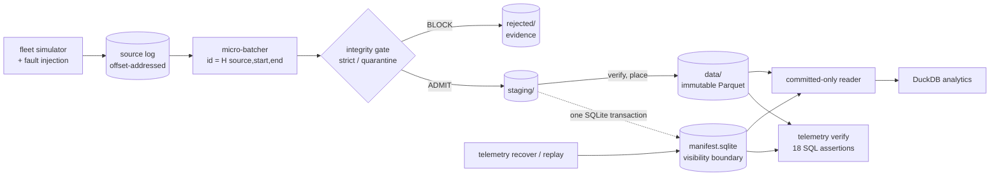

# Telemetry Lakehouse

An integrity-gated streaming-to-Parquet pipeline in Python. A simulated device fleet is consumed as bounded
micro-batches, validated by an explicit integrity gate, written as immutable partitioned Parquet, and made
visible by a single SQLite transaction. DuckDB then answers analytical questions **and independently proves**
that the published data satisfies its documented invariants.

> Data must never become trusted merely because it was successfully written to storage.

**Why this exists.** Most pipeline demos stop at "the files were written". The interesting engineering is
everything between *received* and *trusted*: duplicates and conflicts, reordering vs. real loss, partial
publication, crashes mid-commit, recovery without double-publishing, and evidence that the result is correct.
This repository builds that end to end, tests it with real process kills, and is explicit about what it does
**not** guarantee.

## 70-second demo



*A real run, replayed:* the output text and exit statuses are exactly what the commands produced
([transcript](docs/demo/transcript.txt), [raw capture](docs/demo/session.json)); only the typing speed and output
pacing are synthetic. The commands themselves took ≈ 3 s in total. Regenerate it with
`uv run python scripts/record_demo.py`; the full eight-step demonstration is [`scripts/demo.sh`](scripts/demo.sh).

## Architecture



A batch is **received → validated → staged → verified → committed**; only the last state is visible to trusted
readers. Details, state machine and sequence diagram: [docs/architecture.md](docs/architecture.md).

## Technology choices and trade-offs

| Choice | Why | Cost |
|---|---|---|
| Python (tested on 3.14) | Fast iteration; mature Arrow/DuckDB/Pydantic | Single-threaded validation, ≈ 4.8 µs/event |
| PyArrow + Parquet (ZSTD) | Explicit schemas; immutable columnar files; smallest files in the sweep | One small file per batch per date; no compaction yet |
| SQLite (WAL, `synchronous=FULL`) | Atomic multi-row commit, `CHECK`/`UNIQUE` constraints, zero operations | Single writer; see [why not Iceberg/Delta](docs/design_sqlite_vs_table_formats.md) |
| DuckDB | SQL verification and analytics straight over Parquet; no server | In-process only |
| Pydantic | Strict contract validation and validated configuration | Dominates per-record gate cost |
| pytest + Hypothesis | Unit, integration, property-based, and real-process-kill tests | — |
| uv + Ruff + GitHub Actions | Reproducible environments, fast lint/format, CI | — |

No Kafka, Flink, Spark, Kubernetes or cloud services — on purpose. The source (`JsonlSource`) and storage
(`StorageLayout`) are the two seams where a broker or an object store would plug in.

## Setup

```bash
uv sync                  # Python 3.14 tested (>= 3.12 declared); pyarrow, duckdb, pydantic (+ pytest, hypothesis, ruff)
make test                # or: uv run pytest   (353 tests, ~30 s)
make lint
```

**Python 3.14 compatible:** developed and tested on 3.14.4 (macOS, Apple silicon), and CI runs the full suite, the demo
and a benchmark smoke test on Python 3.14 (Ubuntu and macOS). `pyproject.toml` declares `requires-python >= 3.12`
(the project brief's floor), but only 3.14 is tested.

## Demo: the eight Definition-of-Done steps

```bash
scripts/demo.sh        # ~1 min; every expectation is machine-checked; exits non-zero if any fails
```

It (1) generates a deterministic dataset, (2) ingests it into partitioned Parquet, (3) submits a corrupted batch
and observes publication being **blocked**, (4) shows the trusted dataset is **byte-identical**, (5) kills the
process inside the commit transaction, (6) **recovers** with no duplicate or partial publication, (7) lets the
producer fix the source so the rejected batch is resubmitted and accepted, and (8) proves the invariants with 18
DuckDB assertions and replays every committed batch from the source — then runs the test suite and a small
benchmark. `EVENTS=20000 RUN_TESTS=0 RUN_BENCH=0 scripts/demo.sh` is the quick form.

### Commands

```bash
uv run telemetry simulate --devices 1000 --events 100000 --seed 42 [--fault duplicate=0.01 --fault drop=0.001 …]
uv run telemetry ingest   --batch-size 5000 [--mode quarantine] [--resume]
uv run telemetry status                       # batch states from the manifest
uv run telemetry recover  [--repair]          # resolve unfinished batches, sweep orphans, check files
uv run telemetry replay                       # rebuild committed batches from the source and compare
uv run telemetry verify   [--allow-incomplete]  # 18 independent SQL assertions -> PASS/FAIL
uv run telemetry query    --name hourly-device-health   # also: fleet-summary, battery-health
uv run telemetry benchmark --events 1000000 --repeats 3 --batch-sizes 1000,5000,20000 --compressions zstd,snappy
```

`--root` (or `TELEMETRY_ROOT`) selects the lakehouse directory (default `./lakehouse`). Logs are JSON lines on
stderr; results go to stdout. Exit codes: `0` ok · `1` runtime failure · `2` usage/config error · `3` integrity
finding (batch blocked, sequence gaps proven, verification failed, unresolved recovery). Fault injection kinds:
`drop duplicate conflict reorder delay malformed invalid_value unsupported_version clock_skew_future
clock_skew_past`, plus `--interrupt-after N`. Crash testing from the shell:
`TELEMETRY_FAILPOINT=in_commit:3 uv run telemetry ingest …` kills the process at that point (exit 137).

## Data model and partitioning

Eleven required, non-null fields (`event_id`, `device_id`, `sequence_number`, `event_time`, `ingestion_time`,
`schema_version`, `temperature_c`, `humidity_pct`, `battery_pct`, `signal_dbm`, `status`), closed measurement ranges
(violations are rejected, never clamped), timezone-aware timestamps normalised to UTC, strict types, supported
versions only. Full contract: [docs/data_contract.md](docs/data_contract.md).

```
data/event_date=2026-01-01/<batch_id>.parquet     # UTC date of event_time; one file per (batch, date)
```

Files are immutable, sorted by `(device_id, sequence_number)`, ZSTD by default, created with a no-clobber fsynced
write, and trusted **only** if a committed manifest row references them.

## Integrity guarantees (and their limits)

* **Accounting:** every source record lands in exactly one of *accepted / duplicate / rejected / unresolved*;
  `consumed = accepted + duplicates + rejected + unresolved` is checked per batch and re-checked in SQL.
* **Identity:** identical re-delivery is a benign duplicate; same `event_id` with a different payload, or one
  `(device, sequence)` claimed by two events, is a conflict that blocks the batch. Uniqueness is also a database
  constraint at commit.
* **Sequences:** out-of-order arrival is normal; a gap is *loss* only when proven by a watermark or the source's
  end-of-stream marker. Interrupted sources get no marker, and verification says so (`SKIP`) instead of passing.
* **Admission:** strict (default) blocks the *whole* batch on any rejected/unresolved record; `--mode quarantine`
  sets bad rows aside with full payloads and publishes the rest. Both write evidence under `rejected/`.
* **Atomic visibility:** a batch becomes visible in one SQLite transaction — for **manifest-aware readers**.
  A reader that globs `data/` is *not* protected between a crash and `recover`.
* **Not claimed:** end-to-end exactly-once, multi-writer safety, power-loss durability on macOS (`fsync` there does
  not flush the drive cache), or completeness beyond what the source's end-of-stream marker states.

Reasoning, reason codes and test evidence: [docs/correctness.md](docs/correctness.md).

## Recovery semantics

Crash windows are named failpoints, each tested in-process and with a **real `os._exit(137)`** process kill.
At every window readers see only whole committed batches. `telemetry recover` then, per unfinished batch:
**resumes** if every recorded file has an intact copy and its content digest matches what the gate approved,
otherwise **replays** the recorded source interval through the same pipeline; orphans are moved to
`rejected/orphans/` as evidence (never deleted); damaged committed files are detected and restored only if
replay reproduces the committed bytes exactly. Crash → recover → ingest ends **byte-identical** to a run with no
crash. Re-submitting a committed batch is a no-op; a source that changed under a committed batch is refused.
Full table: [docs/recovery.md](docs/recovery.md).

## SQL verification

`telemetry verify` evaluates 18 assertions (one `.sql` file each in
[`sql/assertions/`](src/telemetry_lakehouse/sql/assertions)) against the committed Parquet and the manifest
loaded into DuckDB — it shares no validation code with the writer and does not trust the manifest's hashes.

```sql
-- unique_event_id (a violation is any row returned)
SELECT event_id, count(*) AS copies, list(DISTINCT filename) AS files
FROM events GROUP BY event_id HAVING count(*) > 1;

-- partition_matches_event_time
SELECT event_id, event_date, CAST(event_time AT TIME ZONE 'UTC' AS DATE) AS utc_date, filename
FROM events WHERE event_date <> CAST(event_time AT TIME ZONE 'UTC' AS DATE);
```

Categories: identity, contract, partitioning, reconciliation, trust (no rejected-batch rows, no unreferenced files),
consistency (manifest vs. physical files), completeness. Sample, after killing a process mid-commit and *before*
recovery:

```
FAIL  trust          no_unreferenced_files_in_data        1 violation(s)
FAIL  consistency    no_unfinished_batches                1 violation(s)
FAIL  completeness   sequences_complete_to_end_of_stream  1000 violation(s)
RESULT: FAIL - 3 fail, 15 pass (18 assertions)        # exit 3; after recover + ingest: 18 pass, exit 0
```

Every assertion was neutered in turn to prove the tests catch it; a file rewritten with out-of-range values *and* a
patched manifest hash is still caught by the content assertions. See [docs/correctness.md §7](docs/correctness.md).

## Benchmark methodology and results

**Methodology** (full detail and caveats in [docs/benchmarks.md](docs/benchmarks.md)):

* **Workload:** a seeded simulator (1,000 devices, ≈ 306 bytes of JSON per event, clean stream). The source log is
  generated once per scale; generation time is reported separately and never included in ingest time.
* **Isolation:** every ingest measurement runs in a **fresh subprocess on a fresh lakehouse directory**, so peak RSS
  (`ru_maxrss`) is per run and nothing is warm. Wall time is taken inside the worker around `run_ingest` only.
* **Repeats and statistics:** 3 repeats at 100k and 1M (median shown, min–max in the raw results); **1 run at 10M**,
  so 10M figures carry unknown variance. Observed run-to-run spread at 1M was about ±5%.
* **What each timer covers:** *gate* = parse + validate + identity + sequence checks of one batch; *stage* = build the
  Arrow table, sort, encode Parquet, fsync, hash and record files; *publish* = the whole per-batch path (gate → stage →
  verify → place → commit). Query latency includes opening the DuckDB connection and creating the view.
* **Sweeps:** batch size (1k–100k) and codec (zstd, snappy, lz4, gzip, none) at 1M events; recovery, replay and verify
  timings on the same dataset.
* **Nothing is estimated:** every figure comes from a JSON file in [`benchmarks/results/`](benchmarks/results). The
  harness is `telemetry benchmark` (source: `src/telemetry_lakehouse/benchmark.py`).
* **Caveats:** one machine, one filesystem; `fsync` on macOS does not flush the drive cache; CI numbers are not
  comparable.

**Reproduce:**

```bash
uv run telemetry benchmark --events 1000000 --scales 100000 --repeats 3 \
    --batch-sizes 1000,5000,20000,100000 --compressions zstd,snappy,lz4,gzip,none --label mine
uv run telemetry benchmark --events 10000000 --repeats 1 --no-recovery --label scale-10M    # ~20 min, ~3.6 GB scratch
uv run telemetry benchmark --render-only benchmarks/results/<file>.json                     # re-render a result as tables
```

**Results** — Apple M4 Max, 14 cores, 36 GiB, macOS, Python 3.14.4, pyarrow 26.0.0, duckdb 1.5.6; batch 5,000, ZSTD.

| Events | Wall time | Events/s | Peak RSS | Parquet | Batch validation (p50) | Per-batch publish (p50 / p95) |
|---:|---:|---:|---:|---:|---:|---:|
| 100,000 | 1.2 s | 81,696 | 205 MB | 4.6 MB | 22.7 ms | 54 / 65 ms |
| 1,000,000 | 17.0 s | 58,785 | 731 MB | 46.0 MB | 23.4 ms | 68 / 141 ms |
| 10,000,000 | 576 s | 17,350 | 3,629 MB | 463 MB | 24.4 ms | 178 / 829 ms |

* A profile-driven change (`event_index` redesign + SQLite tuning, durability unchanged) took 1M events from
  29,441 to 58,785 events/s.
* At 10M the commit stage is 84% of wall time; a 2 GiB SQLite cache did **not** help. The cause is open.
* Batch size 1,000 → 100,000 (1M events): 39k → 74k events/s, publish latency 20 ms → 1.1 s. ZSTD was smallest and,
  within noise, fastest; gzip clearly slowest.
* DuckDB over 1M events: 13–41 ms per query (incl. opening the connection); over 10M: 0.09–0.35 s.
* 1M events: crash recovery 0.6 s (resume) / 2.2 s (replay); replay of every committed batch 11 s, all identical;
  `verify` 1.9 s.

## Future improvements

* Look the identity index up on demand (SQLite) instead of holding it in memory; find the cause of the 10M commit
  slowdown (candidates in the benchmark doc are untested).
* Parallel or vectorised validation; compaction of small files; persisted gap ledger.
* A real broker source and an object-store backend behind the existing seams; migrate to Iceberg/Delta when the
  [criteria](docs/design_sqlite_vs_table_formats.md#7-when-a-full-transactional-table-format-becomes-necessary) are met.
* Leases/fencing for multi-process safety; per-device clock model; continuous (not on-demand) verification.
* Linux and `F_FULLFSYNC` measurements; power-loss testing.

## Repository map

```
src/telemetry_lakehouse/   package (sql/ and sql/assertions/ ship inside it)
tests/{unit,integration,property,failure_injection}/
benchmarks/                sqlite micro-benchmark + results/*.json (raw measurements)
scripts/demo.sh            the end-to-end demonstration
docs/                      architecture · data_contract · correctness · recovery · benchmarks · design note
.github/workflows/ci.yml   lint, test matrix, demo, benchmark smoke
```

## Troubleshooting

* macOS: if `uv run telemetry` says `No module named 'telemetry_lakehouse'`, the editable-install `.pth` file inside
  `.venv` was flagged *hidden* (Python skips hidden `.pth` files; observed after `uv` rebuilt the project in some
  folders). Fix: `chflags -R nohidden .venv`. The test suite is unaffected (`pythonpath = ["src"]`).
