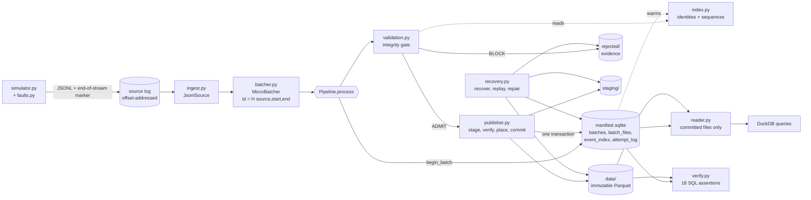
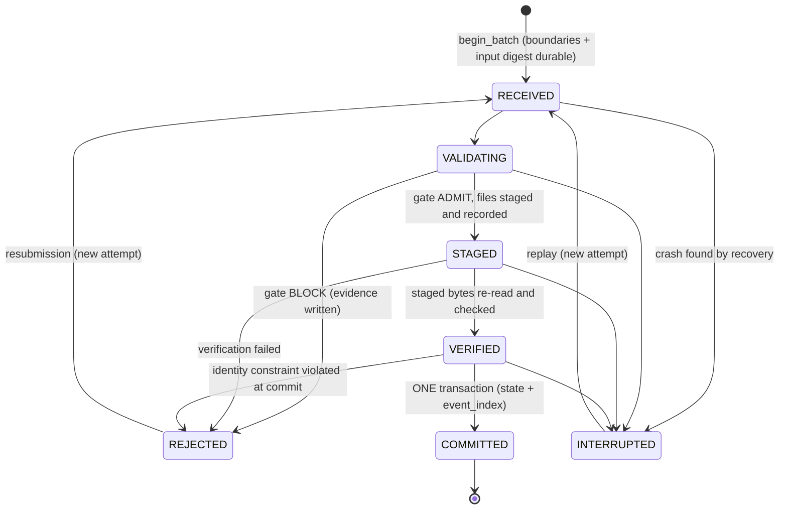
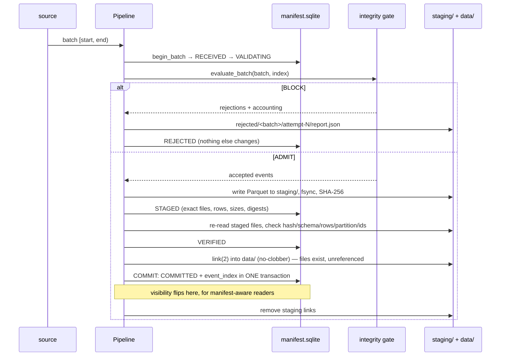

# Architecture

Everything described here is implemented and tested; limitations are listed in §9. Companion documents:
[data_contract.md](data_contract.md) · [correctness.md](correctness.md) (integrity gate, SQL verification) ·
[recovery.md](recovery.md) (publication protocol, crash windows) · [benchmarks.md](benchmarks.md) ·
[design_sqlite_vs_table_formats.md](design_sqlite_vs_table_formats.md).

## 1. Central principle

> Data must never become trusted merely because it was successfully written to storage.

Every event is in exactly one of four trust states. Only the last is visible to analytical readers.

| State | Meaning | Where it lives |
|---|---|---|
| **Received** | Read from the source at known offsets; nothing verified | memory; batch boundaries durable in the manifest |
| **Validated** | Passed contract + identity + sequence checks (the *integrity gate*) | memory |
| **Staged** | Written as Parquet, fsynced, SHA-256 recorded, re-read and checked — still untrusted | `staging/` |
| **Committed** | Referenced by a `COMMITTED` batch row in the SQLite manifest | `data/` + `meta/manifest.sqlite` |

A Parquet file existing in `data/` is **not** evidence of commitment. The manifest commit is.

## 2. Component diagram



Each box is independently testable: `MicroBatcher` is a pure iterator transform, the gate (`evaluate_batch`) writes
nothing, `write_batch` is a pure function of `(table, batch_id, layout, config)`, and recovery reuses the same
`Pipeline` as ingestion so a replay cannot behave differently from a first run.

### Module map

| Module | Responsibility |
|---|---|
| `config.py` | Pydantic configs (simulator, faults, batching, storage, gate); invalid values fail fast |
| `schemas.py` | Event contract (`TelemetryEvent`), explicit `EVENT_SCHEMA`, ranges, supported versions |
| `simulator.py`, `faults.py` | Deterministic fleet, stable IDs, reference dataset; seeded fault injection with ground truth |
| `batcher.py` | Bounded buffering, deterministic batch IDs, offset-continuity check, optional time flush |
| `ingest.py` | `JsonlSource`, `Pipeline` (one batch to a durable outcome), run summary and metrics |
| `validation.py`, `index.py` | Integrity gate, accounting, admission policy; committed identities + sequence tracker |
| `evidence.py` | Rejection reports and quarantine files under `rejected/` |
| `parquet_writer.py`, `layout.py`, `fsutil.py` | Date partitioning, ZSTD, fingerprints; storage areas; durable no-clobber writes |
| `publisher.py`, `manifest.py`, `failpoints.py` | Stage→verify→place→commit; SQLite schema + state machine; named crash points |
| `recovery.py` | Resume-or-replay, orphan sweep, committed-file checks, deterministic replay, repair |
| `verify.py`, `sql/assertions/` | Independent DuckDB assertions → PASS/FAIL report |
| `reader.py`, `sql/*.sql` | Committed-only DuckDB view; named analytical queries |
| `benchmark.py`, `cli.py`, `log.py` | Benchmark harness; CLI and exit codes; JSON logs |

Deviation from the suggested layout: `sql/` lives inside the package so queries and assertions ship with the wheel
and the CLI works from any directory. `layout.py` and `fsutil.py` were added because several modules need them.

## 3. Storage areas

```
<root>/
  source/      raw source logs + sidecar (end-of-stream marker)         input
  staging/     <batch_id>/event_date=…/<batch_id>.parquet               untrusted candidates
  data/        event_date=YYYY-MM-DD/<batch_id>.parquet                 immutable; trusted ONLY if referenced
  rejected/    <batch_id>/attempt-N/{report.json,quarantine.jsonl,      evidence, never queried as data
               staging-remnants/}, orphans/…
  meta/        manifest.sqlite, completeness-*.json, verify-report.json publication metadata
```

Partitioning is Hive style by **UTC** `event_date` (derived from `event_time`, not stored in the file), one file per
`(batch, date)`, rows sorted by `(device_id, sequence_number)`, ZSTD by default, configurable row-group size. File
paths are a pure function of `(event_date, batch_id)`, so a batch that spans midnight writes two files and a retry
can never write to a different place.

## 4. Batch state machine



Every transition is a compare-and-set (`UPDATE … WHERE state = ?`); `COMMITTED` is terminal. The schema itself
(`CHECK`, `UNIQUE`) enforces invariants such as `committed_rows = accepted` and one row per `event_id` and per
`(device_id, sequence_number)`.

## 5. Publication protocol



The visibility boundary is the single commit transaction. Visibility is atomic for *manifest-aware* readers
(`reader.visible_files`, `telemetry query`, `telemetry verify`); a reader that globs `data/` can see placed-but-
uncommitted files or crash orphans, which is why `verify` flags them and `recover` moves them to `rejected/orphans/`.
Crash windows, recovery rules and test evidence: [recovery.md](recovery.md).

## 6. Integrity invariants

Let a batch cover source interval `[s, e)`. Where each is enforced and checked:

| | Invariant | Enforced by | Independently checked by |
|---|---|---|---|
| A1 | `consumed = e − s` | gate | `batch_accounting_identity` |
| A2 | `consumed = accepted + duplicates + rejected + unresolved` | gate (blocks on violation) | `batch_accounting_identity` |
| A3 | `COMMITTED ⇒ committed_rows = accepted`; otherwise `committed_rows` is NULL | manifest `CHECK` | `batch_accounting_identity` |
| A4 | Parquet rows = manifest file rows = `event_index` rows = `committed_rows` | publisher | `batch_row_counts_reconcile` |
| A5 | committed batches cover each source's offsets without holes | — (reported) | `offset_coverage_no_holes` |
| I1 | `event_id` unique across committed data | gate + `event_index` unique key | `unique_event_id`, `events_and_index_agree` |
| I2 | `(device_id, sequence_number)` unique | gate + `event_index` unique index | `unique_device_sequence` |
| I3 | identical re-delivery = benign duplicate; same id, different payload = conflict | gate | tests (not a static property of the data) |
| S1/S2 | an open gap is not loss; loss is proven only by watermark or end-of-stream marker | `SequenceTracker.finalize` | `sequence_gaps_beyond_grace`, `sequences_complete_to_end_of_stream` |
| P1 | a batch is visible entirely or not at all | single commit transaction | crash-window tests |
| P2 | committed files exist and match size/SHA-256/rows/bounds | publisher | `manifest_files_match_physical` |
| P3 | no non-committed batch's rows in trusted data | reader reads manifest list only | `no_untrusted_batches_in_data` |
| P4 | one batch ID ⇒ at most one committed output | `begin_batch` CAS + input digest | idempotency tests |

Admission policy (strict whole-batch rejection vs row-level quarantine), reason codes and the fault→detection
table are in [correctness.md](correctness.md).

## 7. Guarantees and non-guarantees

* ✅ **Safety:** at every crash window trusted readers see only whole committed batches; nothing is duplicated by retry.
* ✅ **Effectively-once publication per batch interval** for an offset-addressable, replayable, append-only source
  with deterministic batch identity. The resume point comes from the manifest, never from producer memory.
* ✅ **Recovery converges:** crash → `recover` → `ingest` ends byte-identical to an uncrashed run.
* ✅ **Independent proof:** `verify` re-derives soundness from the Parquet and manifest with SQL that shares no
  validation code with the writer.
* ❌ **Not end-to-end exactly-once.** Device→source is at-least-once; duplicates are removed by stable `event_id`.
  Time-based flushing makes boundaries wall-clock dependent, so boundaries are persisted before processing and
  replays reuse the recorded ones.
* ❌ **Not atomic for glob readers**; ❌ **not multi-writer**; ❌ **not power-loss tested** (process death is).

## 8. Technology choices

| Choice | Why | Cost |
|---|---|---|
| Python (tested on 3.14) | Fast iteration, mature Arrow/DuckDB bindings, type hints | Validation is single-threaded (≈ 4.8 µs/event) |
| PyArrow / Parquet | Explicit schemas, partitioned immutable columnar files, ZSTD | Small files per batch (compaction not built) |
| SQLite (WAL, `synchronous=FULL`) | Atomic multi-row commit, relational state, zero operations | Single writer; see [design doc](design_sqlite_vs_table_formats.md) |
| DuckDB | SQL verification and analytics directly over Parquet, no server | In-process only |
| Pydantic | Strict contract validation and validated config | Per-record cost dominates the gate |
| pytest + Hypothesis | Unit, integration, property, and real-process-kill tests | — |
| uv + Ruff | Reproducible environments, fast lint/format | — |

No Kafka/Flink/Spark/cloud services by design; the source (`JsonlSource`) and storage (`StorageLayout`) are the
two seams where a broker or object store would plug in.

## 9. Limitations

* **Glob readers are not protected** between a crash and `recover`; only manifest-aware readers get atomic visibility.
* **Recovery needs the source** for batches that cannot be resumed from intact staged files, and assumes it is
  retained and append-only. `recover` and `ingest` must not run concurrently (no leases or fencing).
* **Memory and start-up scale with committed events.** The in-memory committed index is rebuilt from `event_index`:
  ≈ 360 bytes/event measured (3.6 GB peak RSS at 10M). Lookup-on-demand against SQLite is the next step.
* **Commit time grows with the dataset.** At 10M events the `event_index` insert dominates (84% of wall time, 17k
  events/s vs 59k at 1M); the cause is not established ([benchmarks.md §2](benchmarks.md)).
* **Verification is a snapshot** and trusts DuckDB's Parquet reader and the SHA-256 recorded at commit.
* **Whole-stream completeness** needs the source's end-of-stream marker; otherwise only watermark-grade.
* **Single process, single writer.** No parallelism was attempted.
* **Platform:** developed and measured on macOS with Python 3.14; `fsync` there does not force the drive cache.
  `requires-python >= 3.12` is declared, but only Python 3.14 is tested (locally and in CI on Ubuntu and macOS).
